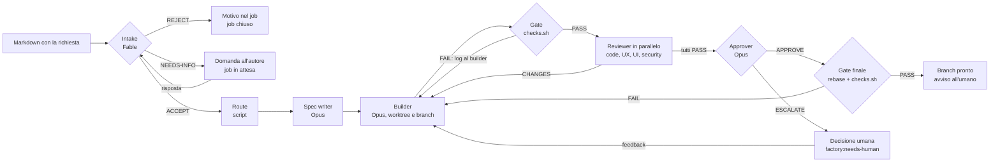

# Software factory

Una pipeline fissa di agenti e script che trasforma richieste in markdown in branch pronti per una PR/MR.
Un solo orchestratore Claude Code (la skill `/factory`) elabora più job in parallelo: Fable fa l'intake,
Opus scrive spec e codice, script deterministici eseguono i test e gestiscono lo stato, i reviewer controllano il codice.
L'approver non fa mai il merge: lascia il branch e avvisa che il job è terminato.



Le frecce verso il builder sono i cicli di correzione: massimo `max_rounds` (default 3) per ciclo, poi il job
passa all'umano con l'etichetta `factory:needs-human`. Il feedback umano apre un nuovo ciclo.

## Requisiti

- Claude Code 2.1.257 o successivo (alias di modello `fable` per l'intake).
- Python 3.10 o successivo, git, bash.
- Gli strumenti del tuo stack (Maven/Gradle, Node, Python, Go, Cargo, .NET) per `checks.sh`.
- Fable può consumare crediti di utilizzo extra, in base al piano.

## Uso

| Comando | Azione |
| --- | --- |
| `/factory run` | Riprende i job interrotti e crea job dai `.md` in `factory/inbox/`. |
| `/factory run <file.md> [altri.md]` | Crea un job per ogni file e avvia la pipeline. |
| `/factory status` | Mostra lo stato dei job senza avviare nulla. |
| `/factory <testo>` | Domanda ("a che punto è il 7?"), feedback ("7: usa la cache esistente"), comando ("riprova 7", "approva 7", "chiudi 7") o nuova richiesta. |
| `cd factory && python3 -m http.server` | Dashboard su `http://localhost:8000/dashboard.html`. |

Per scrivere una richiesta parti da `factory/templates/richiesta.md`. Più è chiaro l'obiettivo, meno domande farà l'intake.

### Quando un job termina

- **done**: il branch `factory/<id>` è nel worktree del job. In `factory/jobs/<id>/HANDOFF.md` trovi il comando
  `git push` e in `PR.md` titolo e descrizione della PR/MR. Dopo il merge: `python3 factory/bin/job cleanup <id>`.
- **needs-info**: rispondi con `/factory <id> <risposta>`; il job torna all'intake.
- **needs-human**: leggi il motivo (`/factory status` o la dashboard) e scegli: feedback con istruzioni
  (`/factory <id> <istruzioni>`, nuovo ciclo dal builder), `riprova <id>` (stesso punto, utile dopo aver
  sistemato `checks.sh`), `approva <id>` (accetti il branch così com'è) oppure `chiudi <id>`.
- **rejected**: il motivo è nel report di intake. Un feedback riapre l'intake.

## Come funziona

- **Stato nei file.** Ogni job ha una cartella `factory/jobs/<id>/` con `job.json`, richiesta, spec, report di ogni
  step, log del gate e feedback. Solo `factory/bin/job` scrive `job.json` e rifiuta i passaggi non validi
  (report mancante, verdetto non previsto, ACCEPT senza rischio, DONE con modifiche non committate, APPROVE senza `PR.md`).
- **Ripresa.** Se la sessione si ferma, `/factory run` segna come interrotti gli step rimasti aperti e riprende ogni job dal suo stadio.
- **Isolamento.** Ogni job lavora in un git worktree separato (`../<repo>.factory-worktrees/<id>`, branch `factory/<id>`):
  il tuo checkout principale non viene toccato e più job procedono in parallelo.
- **Il gate decide se il codice funziona.** `factory/bin/gate` verifica worktree pulito, presenza di commit,
  nessun file protetto modificato (`factory/`, `.claude/`), poi esegue `factory/checks.sh` del repository principale
  dentro il worktree. Il builder non può modificare i check che lo giudicano.
- **Gli agenti giudicano il resto.** I reviewer leggono il diff; bloccano solo con un finding dimostrabile (file, riga, scenario).
- **Osservabilità.** Ogni step scrive un report con riepilogo; `factory/jobs/index.json` alimenta la dashboard
  con stadio, rischio, tempo e costo stimato per job.

## Modelli e routing

L'intake assegna rischio (`low`, `medium`, `high`) e superfici (`ui`, `security`). `factory/bin/route` sceglie reviewer e modelli:

| Caso | Code review | Review UX | Review UI | Security review |
| --- | --- | --- | --- | --- |
| Rischio basso | Haiku | – | – | – |
| Rischio medio | Sonnet | – | – | – |
| Rischio alto | Sonnet | – | – | – |
| + superficie UI | – | Sonnet | Haiku | – |
| + superficie security | – | – | – | Opus |

Ogni agente ha un modello configurabile in `factory/config.json` → `agents.<ruolo>.model`
(`haiku`, `sonnet`, `opus`, `fable`). Se è `null` vale la tabella `routing` per i reviewer e il default per gli altri
(intake Fable, spec writer, builder e approver Opus). Il valore esplicito vince sempre. Controlla l'effetto con:

```bash
python3 factory/bin/route --check
python3 factory/bin/route --risk high --surfaces ui,security
```

Il modello lo passa l'orchestratore a ogni avvio di subagent; il campo `model` nei file `.claude/agents/*.md` è solo il fallback.
Se imposti `CLAUDE_CODE_SUBAGENT_MODEL_FORCE=1`, Claude Code ignora entrambi.

**Modelli economici con cautela.** Un reviewer debole può rimandare al builder lavoro valido (un round intero di Opus)
o lasciar passare un problema. Il risparmio per chiamata può diventare un costo maggiore: guarda in dashboard quanti round
causano i reviewer economici prima di abbassare i modelli.

## Configurazione (`factory/config.json`)

| Chiave | Default | Significato |
| --- | --- | --- |
| `concurrency` | 3 | Job lavorati insieme. |
| `max_rounds` | 3 | Passaggi del builder per ciclo prima dell'escalation. |
| `base_branch` | `auto` | Branch base: `origin/HEAD`, poi `main`, `master`, `develop`. |
| `worktrees_dir` | `../{repo}.factory-worktrees` | Dove creare i worktree dei job. |
| `protected_paths` | `factory/`, `.claude/` | Percorsi che il builder non può modificare. |
| `agents` / `routing` | vedi sopra | Agenti, modelli e reviewer. |
| `approval.always_escalate_risk` | `[]` | Rischi che vanno sempre all'umano, anche se approvati (es. `["high"]`). |
| `gate.timeout_minutes` | 30 | Timeout di `checks.sh`. |
| `gate.final_rebase` | true | Il gate finale riallinea il branch alla base con un rebase. |
| `gate.check_dirs` | `[]` | Cartelle in cui `checks.sh` cerca lo stack (monorepo). |
| `labels` | `factory:*` | Etichette per stadio. |
| `notify_command` | null | Comando eseguito su done, needs-human, needs-info, rejected. |
| `pricing` | listino API | Prezzi per milione di token usati per la stima dei costi. |

### checks.sh

Riconosce da solo Maven, Gradle, Node/TypeScript (npm, pnpm, yarn, bun), Python (ruff, mypy, pytest), Go, Rust e .NET,
anche in sottocartelle di primo livello. Per controllare tutto tu, crea `factory/checks.local.sh`: se esiste viene eseguito
al posto del rilevamento. Exit code: `0` ok, `1` check falliti (il job torna al builder), `78` niente da eseguire (il job va all'umano).

### Permessi

I subagent in background chiedono i permessi nella sessione dell'orchestratore. `install.sh` aggiunge a
`.claude/settings.local.json` (locale alla macchina, non va committato) le regole per gli script della factory e i comandi git nei worktree, nega `git push`
e registra la cartella dei worktree in `additionalDirectories`. Per lavorare senza conferme continue avvia Claude Code
in modalità `acceptEdits` o `auto`: i subagent ereditano la modalità della sessione principale.

## Costi

La dashboard mostra un costo stimato per step e per job, calcolato leggendo le trascrizioni dei subagent di
Claude Code (`~/.claude/projects/.../subagents/agent-*.jsonl`) con i prezzi di `config.json`.

- È un prezzo equivalente API, non la fattura di un piano in abbonamento.
- Il costo dell'orchestratore non è attribuito ai singoli job.
- Il formato delle trascrizioni non è un'interfaccia pubblica: un aggiornamento di Claude Code può interrompere il calcolo.
  Ricalcolo manuale: `python3 factory/bin/job cost --force`.
- Claude Code cancella le trascrizioni dopo `cleanupPeriodDays` (30 giorni di default); i costi già calcolati restano in `job.json`.

## Limiti e precauzioni

- Ctrl+C nella sessione orchestratore ferma tutti i subagent: il lavoro in corso si perde. `/factory run` riprende dallo stadio.
- I dati dei job restano sul tuo computer (`factory/jobs/` è in `.gitignore`).
- La factory è una base valida, non un sistema da lasciare senza supervisione: leggi le PR prima del merge.
- Il passo successivo è portarla in cloud con Claude Agent SDK, riusando script e prompt.

## File

| File | Funzione |
| --- | --- |
| `.claude/skills/factory/SKILL.md` | L'orchestratore (`/factory`). |
| `.claude/skills/factory/reference.md` | Macchina a stati, formato dei report, comandi. |
| `.claude/agents/factory-*.md` | Un file per ruolo: 8 agenti. |
| `factory/bin/job` | Unico script che scrive `job.json`. Rifiuta i passaggi non validi. |
| `factory/bin/gate` | Esegue `checks.sh` nel worktree del job. |
| `factory/bin/route` | Sceglie reviewer e modelli. |
| `factory/bin/factorylib.py` | Funzioni condivise (config, routing, git, costi). |
| `factory/checks.sh` | Test, lint, type check e build del progetto. |
| `factory/config.json` | Concorrenza, round massimi, etichette, routing, prezzi. |
| `factory/dashboard.html` | Dashboard locale. |
| `factory/inbox/` | Richieste da acquisire con `/factory run`. |
| `factory/jobs/` | Stato dei job. Locale, in `.gitignore`. |

## Licenza

Da definire. Il documento di progetto indica GPLv3 con licenza separata per uso commerciale closed-source:
se confermi, aggiungi il file `LICENSE` nella radice del kit.
